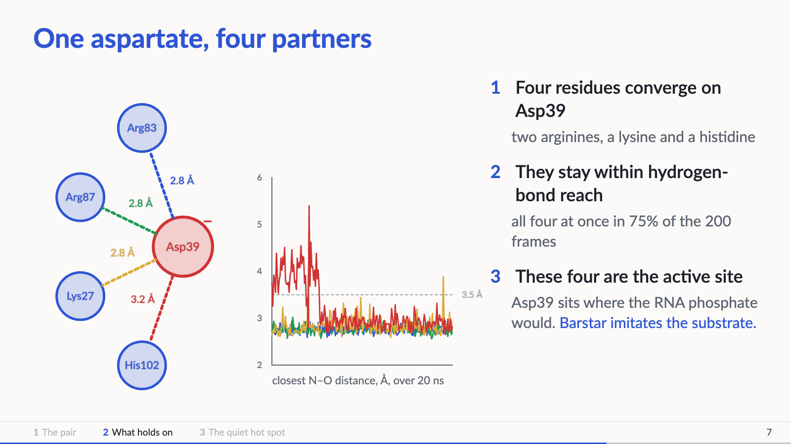
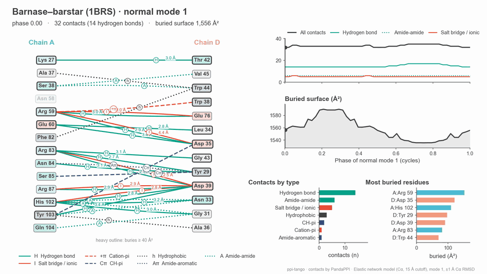

<p align="center"></p>

# ppi-tango

**It takes two.** Animated protein-protein interface contacts from normal modes, molecular
dynamics and free energy perturbation.

[PandaPPI](https://github.com/pritampanda15/PandaPPI) draws every contact at an interface from one
static structure. ppi-tango runs it on every frame of a moving complex and turns the result into
things you can put in a talk:


| Output | File | What it is |
| --- | --- | --- |
| **2D movie** | `*_contacts.mp4` (`.gif`) | PandaPPI's interaction map, alive: contact lines fade in and out, distances tick, bars and timelines follow along |
| **Interactive 3D viewer** | `*_viewer.html` | The real models moving, every contact drawn between its two atoms with a live distance, camera presets, a guided tour, and the 2D map in sync. One self-contained file, works offline |
| **3D movie** | `*_3d.mp4` | Ray-traced models next to the live 2D map; the camera flies in to the interface and around it. Needs PyMOL |
| **Tables** | `*_contacts.csv`, `*_buried_surface.csv` | Every contact and every buried residue in every frame |

## Install

```bash
pip install "ppi-tango[md] @ git+https://github.com/varunsharm16/ppi-tango"
```

That is everything for normal modes, MD and FEP input, the 2D movie and the interactive viewer
(ffmpeg comes bundled). Leave out `[md]` if you only need normal modes or multi-model PDB files.
The 3D movie additionally needs the `pymol` command:

```bash
conda install -c conda-forge pymol-open-source
```

## Use

### Normal mode analysis: just a PDB file

```bash
ppitango nma 1BRS.pdb --chains A D
```

The elastic network model is built in: no other program needed. `--mode 2` picks another mode,
`--rmsd 1.5` a larger swing.

### Molecular dynamics: a topology and a trajectory

```bash
ppitango md top.pdb traj.dcd --chains A D --dt 0.1          # OpenMM, NAMD: PDB + DCD
ppitango md md.tpr md.xtc                                   # GROMACS (or md.gro md.xtc)
ppitango md complex.prmtop md.nc                            # Amber
ppitango md step5.psf step5.dcd --dt 0.1                    # CHARMM / NAMD
```

Give the files as your MD program wrote them. The first file is any structure or topology
[MDAnalysis](https://www.mdanalysis.org) reads (pdb, gro, tpr, prmtop/parm7, psf) that holds **the same atoms
in the same order** as the trajectory (xtc, trr, dcd, nc ...). Nothing needs preparing by hand:

- **Water, ions, lipids, ligands and hydrogens** are dropped. What stays is every residue with a protein or
  nucleic acid backbone, whatever the force field calls it (HIE, HSD, CYX ... are understood).
- **Periodic boxes**: chains cut by the box are made whole and the two partners are put back next to each
  other in every frame, so a raw trajectory works without `gmx trjconv -pbc` or `cpptraj autoimage`.
- **Chains.** With chain IDs in the topology, `--chains A D` picks two; left out, the pair with most contacts
  is followed. Files without chain IDs (gro, prmtop, most psf) get their chains lettered A, B, C ... in file
  order, split wherever the backbone breaks, and the table is printed so you can pick:

  ```
  Chains (no chain IDs in the topology: chains lettered in file order, split where the backbone breaks):
    A: 108 residues, VAL3 to ARG110
    B: 87 residues, LYS1 to SER89
  ```

- **Anything else is a selection**: `--select "segid PROA" "segid PROB"`, `--select "resid 1-220" "resid 221-330"`,
  or a side made of several chains, `--select "chainID H L" "chainID W"` for an antibody against its antigen
  ([selection language](https://userguide.mdanalysis.org/stable/selections.html)).
- **Residue numbers.** A `.tpr` and an Amber `prmtop` count residues 1, 2, 3 ... straight through all chains,
  so the second chain starts at 109 instead of 1. `--renumber B:1` (chain, number of its first residue) puts
  a chain back on its own numbers; a `.gro` or PDB as topology keeps the original numbers by itself.
- **Water-mediated contacts**: `--waters` follows the waters within hydrogen-bond reach of both sides in every
  frame (give the full-system topology and trajectory, not a stripped one).
- **Protein-DNA and protein-RNA**: `--select protein nucleic` puts all protein chains on one side and both
  strands on the other. Hydrogen bonds come from PandaPPI; salt bridges from Arg, Lys and His to backbone
  phosphates are added by ppi-tango. Works the same for `nma` (the network gets a node at C4' of every
  nucleotide) and `fep`.
- **Time axis**: read from the trajectory when it stores times (xtc, trr, nc). DCD files do not, so give
  `--dt` (time between saved frames, with `--unit`), or the axis counts frames.
- **Long trajectories**: 200 evenly spaced frames are analysed (`--max-frames`, `--stride`), and only those
  are read, so trajectory length hardly matters.

A multi-model PDB on its own works too.

### Free energy perturbation: one trajectory per λ window

```bash
ppitango fep top.pdb window_*.dcd --chains A D --dg dg.csv --label "barstar Y29 side chain off"
```

`dg.csv` has one row per window and a `dG` column (cumulative free energy, kcal/mol, from
alchemlyb / pymbar / your FEP package). The free energy curve is drawn against λ next to the
contacts that go with it.

### Options that matter

| Option | |
| --- | --- |
| `--chains A B` | the two chains to follow (default: the pair with most contacts) |
| `--movie3d` | also render the split-screen 3D movie |
| `--gif` | also convert the movies to GIF (for READMEs and chat; use the MP4 in slides) |
| `--smooth N` | rolling window over N frames. Contacts hovering around a cutoff would flicker; this turns flicker into fades (default 5 for MD/FEP, off for normal modes) |
| `--seconds`, `--fps` | movie length and frame rate |
| `--max-residues` | residues per chain on the 2D map (default 14, the busiest ones) |
| `--title` | title on the movies and viewer |

`ppitango nma --help` (and `md`, `fep`) lists the rest.

### In slides

The movies are H.264 MP4 and play in PowerPoint, Keynote and Google Slides. The viewer is a
single HTML file, so in any web-based deck (reveal.js, including
[live slides](https://github.com/ramithuh/protein-design-interactive-slides)) it is one line:

```html
<iframe src="barnase_barstar_md_viewer.html#autoplay" style="width:100%;height:100%;border:0"></iframe>
```

`#autoplay` starts playback, `#tour` also starts the camera tour. In the viewer: drag to rotate,
scroll to zoom, click a contact or residue on the map to fly to it, click a legend chip to hide a
contact type, space to play, arrow keys to step.

### As a talk you walk through with the arrow keys

[`slides/talks/barnase_barstar`](slides/talks/barnase_barstar) is a finished ten-slide talk built from the MD
and FEP demos: open `slides/talks/barnase_barstar/index.html` in a browser and press → until it ends. Every
press plays one step: [manim-web](https://github.com/maloyan/manim-web) animations for the diagrams, the real
cartoons following the trajectory in 3D with distances measured live, a camera that moves into the interface.
Nothing else is needed while presenting; the 3D slides can still be dragged and zoomed if someone asks.



It is built on Ramith Hettiarachchi's
[live slides template](https://github.com/ramithuh/protein-design-interactive-slides) (a copy is in `slides/`;
[`slides/AGENTS.md`](slides/AGENTS.md) has its conventions). To make the same kind of talk from your own run:

```bash
python slides/tools/prep_interface.py top.pdb traj.dcd --chains A D --dt 0.1 --focus D:39 D:29 \
    --dg dg.csv slides/talks/my_talk/data/interface.json
```

writes the one data file the slides draw (cartoons, the trajectory, every contact with its occupancy, the
distances of the `--focus` residues' partners, the FEP curve; needs `mdtraj`). It takes the same input files
as `ppitango md`. Copy
`slides/talks/barnase_barstar` to `slides/talks/my_talk`, keep `slides/stage3d.js` (the 3D stage) and rewrite
the story in the other slide files: the numbers on them are read from the data, the sentences are yours.
`python slides/tools/check_deck.py slides/talks/my_talk` steps through every slide in a headless browser.

To send a talk to someone, pack it into one file that needs nothing next to it and no network (about 7 MB):

```bash
python slides/tools/bundle.py slides/talks/barnase_barstar
```

writes `slides/talks/barnase_barstar/barnase_barstar.html`: attach it to a message or put it on any web host.
Whoever opens it clicks the slide once, then uses the arrow keys.

### From Python

```python
import ppitango

ens = ppitango.md('top.pdb', 'traj.dcd', chains=['A', 'D'], dt=0.1)   # or ppitango.nma(...), ppitango.fep(...)
result = ppitango.analyze(ens)            # PandaPPI on every frame, in parallel
result.contacts                           # tidy DataFrame: frame, x, type, residue_a, atom_a, residue_b, atom_b, distance
scene = result.scene(smooth=5)            # per-contact occupancy and distance over frames

from ppitango import movie, viewer, movie3d
movie.render(scene, 'contacts.mp4')
viewer.write(scene, 'viewer.html')
movie3d.render(scene, '3d.mp4')
```

## Demos

Everything in [`demos/`](demos) was made with the commands in [`examples/make_demos.sh`](examples/make_demos.sh).
Open the `*_viewer.html` files in a browser after cloning (GitHub does not render them in place).

| Complex | Motion | Files |
| --- | --- | --- |
| Barnase-barstar (1BRS, chains A/D) | 20 ns explicit-solvent MD | `barnase_barstar_md_*` |
| Barnase-barstar | FEP: barstar Tyr29 side chain switched off over 12 λ windows | `barnase_barstar_fep_*` |
| Barnase-barstar | normal mode 1 | `barnase_barstar_nma_*` |
| Fab-VEGF (1BJ1, chains H/W), PandaPPI's own example | normal mode 1 | `fab_vegf_nma_*` |
| ACE2-SARS-CoV-2 RBD (6M0J, chains A/E) | normal mode 1 | `ace2_rbd_nma_*` |



The MD and FEP runs are in [`examples/simulations/simulate.py`](examples/simulations/simulate.py)
(OpenMM, Amber14SB/TIP3P, 150 mM NaCl, 298 K); their trajectories are in
`examples/simulations/output`, so `examples/make_demos.sh` runs as is. They are short
demonstration runs, not converged production data: see the notes below.

## What was tested, and known limits

Version 0.1 was run on the same 195-residue complex as four MD programs write it, and each input had to give
the contacts of the reference run (`tests/test_trajectory.py` keeps the core of this, and runs on every push):

| Input | Result |
| --- | --- |
| GROMACS 2025: `md.tpr` or `md.gro` + raw `md.xtc` (dodecahedron box, water, ions, molecules cut by the box) | same contacts and distances as the `trjconv -pbc mol` trajectory |
| GROMACS protein-only `.gro`/`.pdb` + `.xtc` | same |
| Amber: `prmtop` + NetCDF, full system (truncated octahedron) and stripped; `ambpdb`-style PDB without chains | all four agree |
| CHARMM-style PSF + DCD; PDB with HSD, ILE CD, OT1/OT2 and segment names only | same as reference |
| OpenMM PDB + DCD, multi-model PDB, FEP windows | unchanged from the demos |
| 12,800-frame trajectory (150 MB) | 70 s on 8 cores without movies |
| Antibody heavy + light chain against antigen (`--select`) | runs |
| Protein-DNA (λ repressor-operator, 1LMB): 50 ps of explicit-solvent MD with water, normal modes, and the FEP path on stand-in windows | run; phosphate salt bridges and water-mediated contacts found |
| Python 3.9 and 3.12 on macOS; 3.10, 3.12, 3.13 on Linux, 3.12 on macOS and Windows (CI) | pass |
| Alliance Canada cluster (narval) login node, no display: fresh virtualenv from the site wheels (numpy 2.4, MDAnalysis 2.10), `.gro` + raw `.xtc`, `--waters`, normal modes, 2D movie | run; a GROMACS 2026 `.tpr` is too new for MDAnalysis (see below) |

What does not work, or needs care:

- **Topology and trajectory must match atom for atom.** A protein-only trajectory with the full-system
  topology (or the reverse) stops with an error saying so; write both for the same group of atoms.
- **A GROMACS `.top` is not accepted** (it has no coordinates or atom order of the built system): give the
  `.tpr` or `.gro`.
- **A `.tpr` from a very new GROMACS** may be ahead of MDAnalysis: GROMACS 2026 files are not read by
  MDAnalysis 2.10, GROMACS 2025 files not by MDAnalysis 2.7. ppi-tango then uses the `.gro` with the same
  name next to the `.tpr` if there is one, and says so; otherwise write one
  (`gmx editconf -f md.tpr -o md.gro`) and give that.
- **A side made of several chains** whose residue numbers repeat gets the later chains shifted by whole
  thousands (light chain 1-214, heavy chain 1001-1231), which is printed. Insertion codes are ignored.
- **xtc rounds coordinates to 0.01 Å.** A contact sitting exactly on a cutoff can differ between an xtc and
  a full-precision file of the same run; occupancies are not affected in any way that shows.
- **Only protein and nucleic acid.** Contacts to ligands, ions, lipids and glycans are not shown; water only
  with `--waters`. For a water-mediated contact the distance shown is between the two residues' atoms, not to
  the water, and the water itself is not drawn in 3D.
- **Nucleic acids**: base stacking on aromatic side chains and other π contacts with bases are not detected
  (PandaPPI's ring definitions cover amino acids), so protein-DNA maps show hydrogen bonds, phosphate salt
  bridges and water bridges only. Left to itself the tool follows the pair of chains with most contacts,
  which in a protein-DNA complex is the two DNA strands: say `--select protein nucleic`.
- **FEP on protein-DNA** was checked for reading and drawing only, with a plain trajectory cut into stand-in
  windows; no alchemical protein-DNA calculation was run.
- **One frame is not an animation**: `md` on a single structure stops; use `nma`, or PandaPPI for a static map.
- **Residue numbers above 9999** are refused (frames go to PandaPPI as PDB text).
- **3D movie** needs the `pymol` command and is the slow part (about 3 minutes for a 12 s movie on 8 cores);
  everything else runs headless on a cluster login node without it.
- **Windows**: the tests and the README commands pass in CI; the 3D movie (PyMOL) was not tried there.
- **Slides data** (`slides/tools/prep_interface.py`) reads the same inputs (`--select`, `--renumber` too), but
  the deck draws protein cartoons: both sides must be protein.

## How it works, and what to keep in mind

- **Contacts** are PandaPPI's, with its definitions and cutoffs, computed per frame on the heavy
  atoms of the two chains. Hydrogen bonds are therefore distance-based (donor-acceptor ≤ 3.5 Å),
  and water-mediated contacts are not tracked because frames are stripped of solvent. Van der
  Waals atom contacts are counted but not drawn, as in PandaPPI.
- **Occupancy.** A contact is one (type, residue, residue) triple. Its presence over frames is
  smoothed with a rolling mean into an occupancy between 0 and 1, which sets the opacity of its
  line. Its distance is measured in every frame between the two atoms that make it, so the number
  keeps ticking while the line fades.
- **Normal modes** come from an anisotropic network model on Cα atoms (15 Å cutoff). Each residue
  moves rigidly with its Cα along the mode, which is a linear extrapolation: fine for showing which
  contacts a collective motion strains, wrong for large amplitudes (bonds between neighbouring
  residues stretch, atoms can overlap). Keep `--rmsd` near 1 Å. Amplitudes and time scales of a
  mode are not physical.
- **FEP demo.** The example calculation annihilates the barstar Tyr29 side chain beyond Cβ (a
  pseudo-alanine) with 1 ns per window in the complex and in free barstar, analysed with MBAR. It
  gives ΔΔG = 4.0 ± 0.6 kcal/mol; the measured value for Y29A is about 3.4 kcal/mol (Schreiber &
  Fersht, 1995). Treat the agreement as encouraging, not as validation: sampling is short, the
  error bar is statistical only, and a proper mutation would use a hybrid topology.
- **FEP contacts are geometric.** Alchemical atoms stay in the coordinates while they are being
  switched off, so a contact drawn at high λ means "these atoms still sit close", not "this
  interaction still contributes". Watch what the neighbours do as λ grows.
- **One chain pair at a time.** For an antibody, run heavy-antigen and light-antigen separately.
- **Residue numbers** follow PandaPPI (name + number, insertion codes ignored).

## Citing

If ppi-tango helps your work, cite this repository and PandaPPI, which does the contact detection:

```
Varun Sharma. ppi-tango: animated protein-protein interface contacts from normal modes, molecular
dynamics and free energy perturbation. GitHub repository, https://github.com/varunsharm16/ppi-tango

Pritam Kumar Panda. PandaPPI: mapping and visualizing molecular interactions at protein-protein,
protein-nucleic acid and antigen-antibody interfaces. GitHub repository,
https://github.com/pritampanda15/PandaPPI
```

### References

Structures used in the demos (coordinates from the [RCSB PDB](https://www.rcsb.org)):

- **1BRS**, barnase-barstar: Buckle AM, Schreiber G, Fersht AR (1994). Protein-protein recognition: crystal
  structural analysis of a barnase-barstar complex at 2.0-Å resolution. *Biochemistry* 33, 8878-8889.
- **1BJ1**, Fab-VEGF: Muller YA, Chen Y, Christinger HW, Li B, Cunningham BC, Lowman HB, de Vos AM (1998). VEGF
  and the Fab fragment of a humanized neutralizing antibody: crystal structure of the complex at 2.4 Å
  resolution and mutational analysis of the interface. *Structure* 6, 1153-1167.
- **6M0J**, ACE2-SARS-CoV-2 RBD: Lan J, Ge J, Yu J, et al. (2020). Structure of the SARS-CoV-2 spike
  receptor-binding domain bound to the ACE2 receptor. *Nature* 581, 215-220.

Barnase-barstar numbers quoted in the talk and in the notes above:

- Affinity: Schreiber G, Fersht AR (1993). Interaction of barnase with its polypeptide inhibitor barstar
  studied by protein engineering. *Biochemistry* 32, 5145-5150. Hartley RW (1993). Directed mutagenesis and
  barnase-barstar recognition. *Biochemistry* 32, 5978-5984.
- Y29A and the other interface mutants: Schreiber G, Fersht AR (1995). Energetics of protein-protein
  interactions: analysis of the barnase-barstar interface by single mutations and double mutant cycles.
  *J Mol Biol* 248, 478-486.

Methods:

- Normal modes (anisotropic network model): Atilgan AR, Durell SR, Jernigan RL, Demirel MC, Keskin O, Bahar I
  (2001). Anisotropy of fluctuation dynamics of proteins with an elastic network model. *Biophys J* 80, 505-515.
- Simulations: Eastman P, et al. (2024). OpenMM 8: molecular dynamics simulation with machine learning
  potentials. *J Phys Chem B* 128, 109-116.
- Force field and water: Maier JA, et al. (2015). ff14SB: improving the accuracy of protein side chain and
  backbone parameters from ff99SB. *J Chem Theory Comput* 11, 3696-3713. Jorgensen WL, et al. (1983). Comparison
  of simple potential functions for simulating liquid water. *J Chem Phys* 79, 926-935.
- Free energies (MBAR): Shirts MR, Chodera JD (2008). Statistically optimal analysis of samples from multiple
  equilibrium states. *J Chem Phys* 129, 124105.

Software ppi-tango reads with or draws with:

- MDAnalysis: Michaud-Agrawal N, Denning EJ, Woolf TB, Beckstein O (2011). MDAnalysis: a toolkit for the
  analysis of molecular dynamics simulations. *J Comput Chem* 32, 2319-2327.
- MDTraj (slide data, secondary structure): McGibbon RT, et al. (2015). MDTraj: a modern open library for the
  analysis of molecular dynamics trajectories. *Biophys J* 109, 1528-1532. Kabsch W, Sander C (1983).
  Dictionary of protein secondary structure. *Biopolymers* 22, 2577-2637.
- 3Dmol.js: Rego N, Koes D (2015). 3Dmol.js: molecular visualization with WebGL. *Bioinformatics* 31, 1322-1324.
- PyMOL: The PyMOL Molecular Graphics System, Schrödinger, LLC.
- Matplotlib: Hunter JD (2007). Matplotlib: a 2D graphics environment. *Comput Sci Eng* 9, 90-95.

## Credits

Contact detection and the visual language (colours, badges, the map itself) are
[PandaPPI](https://github.com/pritampanda15/PandaPPI)'s, by Pritam Kumar Panda. The viewer uses
[3Dmol.js](https://3dmol.csb.pitt.edu) (BSD-3-Clause, bundled in `ppitango/vendor`); the 3D movie
uses [PyMOL](https://github.com/schrodinger/pymol-open-source). The talk in `slides/` is built on the
[live slides template](https://github.com/ramithuh/protein-design-interactive-slides) (MIT), which bundles manim-web,
three.js, Reveal.js and the Lato font with their licences in `slides/vendor`. MIT licence.
